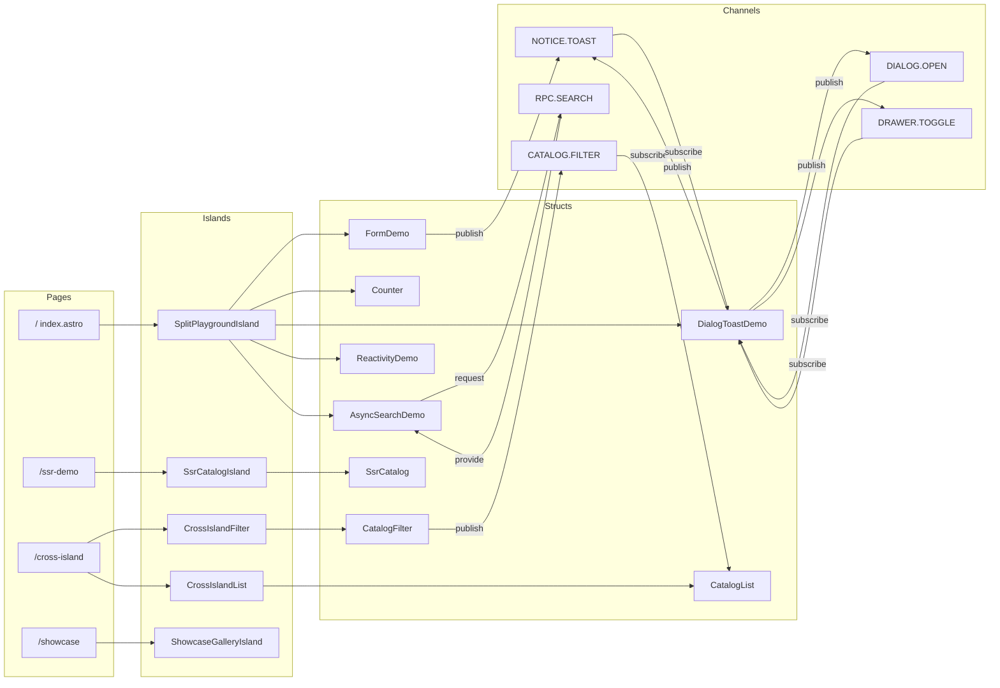

# @actdim/dynstruct-demo Domain Model & Contracts

## 1. Domain Overview

The demo has no backend. Its domain is made of three things:

- **Bus contract**: the typed channels of the portal message bus (`src/bus/portalMsgStruct.ts`).
- **Demo catalog data**: in-memory lists of `DemoCatalogItem` used by the filter, search and SSG demos.
- **Routes and page contracts**: four Astro pages, the props of the shared layout and of the SSG island, and the playground scenario list.

## Entity Taxonomy

| Entity | Defined in | Kind | Notes |
|---|---|---|---|
| `DemoMsgStruct` | `src/bus/portalMsgStruct.ts` | Bus contract | `BaseAppMsgStruct` (from `@actdim/dynstruct/appDomain/appContracts`) `&` `MsgStruct<DemoCustomChannels>` |
| `DemoCustomChannels` | `src/bus/portalMsgStruct.ts` | Channel map | `CATALOG.FILTER`, `NOTICE.TOAST`, `DIALOG.OPEN`, `DRAWER.TOGGLE`, `RPC.SEARCH` |
| `CatalogFilterPayload` | `src/bus/portalMsgStruct.ts` | Payload | `{ query?, category?, minRating? }` |
| `DEFAULT_FILTER` | `src/bus/portalMsgStruct.ts` | Constant | `{ query: '', category: undefined, minRating: 4.0 }` |
| `DemoCatalogItem` | `src/bus/portalMsgStruct.ts` | Data record | Shared by every catalog dataset and by `RPC.SEARCH` output |
| `ToastItem` | `src/components/structs/dialogToastStruct.tsx` | View model | Toast entry kept by `DialogToastDemo` (max 5) |
| `PlaygroundScenario` | `src/data/codeSnippets.ts` | Data record | One entry per playground tab |
| Struct contracts | `src/components/structs/*.tsx` | `ComponentStruct<DemoMsgStruct, ...>` | `props`, `actions`, `msgScope` per component |
| Pages | `src/pages/*.astro` | Routes | `/`, `/ssr-demo`, `/cross-island`, `/showcase` |
| Static assets | `public/` | Files | `favicon.svg`, `llms.txt`, `llms-full.txt` |

### 2.1. Bus channels

| Channel | Kind | `in` payload | `out` payload | Publishers | Consumers |
|---|---|---|---|---|---|
| `CATALOG.FILTER` | Pub/Sub, `replayBufferSize: 1` | `CatalogFilterPayload` | - | `CatalogFilter` | `CatalogList` (`msgBroker.subscribe`) |
| `NOTICE.TOAST` | Pub/Sub | `{ id: string; message: string; severity?: 'success' \| 'info' \| 'warning' \| 'error'; duration?: number }` | - | `DialogToastDemo`, `FormDemo` | `DialogToastDemo` |
| `DIALOG.OPEN` | Pub/Sub | `{ dialogId: string; title: string; content: string }` | - | `DialogToastDemo` | `DialogToastDemo` |
| `DRAWER.TOGGLE` | Pub/Sub | `{ open: boolean }` | - | `DialogToastDemo` | `DialogToastDemo` |
| `RPC.SEARCH` | Request/Response | `{ query: string }` | `{ items: DemoCatalogItem[] }` | `AsyncSearchDemo` (`msgBus.request`) | `AsyncSearchDemo` (`msgBroker.provide`) |

Contract source:

```typescript
export type DemoCustomChannels = {
  'CATALOG.FILTER': { in: CatalogFilterPayload };
  'NOTICE.TOAST': {
    in: { id: string; message: string; severity?: 'success' | 'info' | 'warning' | 'error'; duration?: number };
  };
  'DIALOG.OPEN': { in: { dialogId: string; title: string; content: string } };
  'DRAWER.TOGGLE': { in: { open: boolean } };
  'RPC.SEARCH': { in: { query: string }; out: { items: DemoCatalogItem[] } };
};

export type DemoMsgStruct = BaseAppMsgStruct & MsgStruct<DemoCustomChannels>;
```

Payload rules:

- `CATALOG.FILTER`: the filter UI value `ALL` is sent as `category: undefined`; reset sends the `DEFAULT_FILTER` values.
- `NOTICE.TOAST`: `id` comes from `newMsgId()` (`src/bus/ids.ts`) so rapid toasts never share a React key; missing `severity` is shown as `info`.
- `RPC.SEARCH`: an empty `query` returns the whole search dataset; otherwise a case-insensitive match on title, category and description.

### 2.2. Demo catalog data

```typescript
export type DemoCatalogItem = {
  id: string;
  title: string;
  category: string;
  description: string;
  rating: number;
  badge?: string;
};
```

| Dataset | Location | Ids | Used by |
|---|---|---|---|
| `ALL_ITEMS` | `src/components/structs/catalogListStruct.tsx` | `c1` - `c6` | `CatalogList` on `/cross-island` |
| `SAMPLE_DATABASE` | `src/components/structs/asyncSearchStruct.tsx` (module-private) | `s1` - `s5` | `RPC.SEARCH` provider in `AsyncSearchDemo` |
| `SAMPLE_SSR_CATALOG` | `src/data/sampleCatalog.ts` | `ssr-1` - `ssr-6` | `getSampleCatalog()` for `/ssr-demo`; imported by `e2e/smoke.spec.ts` to assert pre-rendered titles |

Filter categories offered by `CatalogFilter` are `ALL`, `Architecture`, `Networking`, `Performance`, `Reactivity`, `UI`, matching the `category` values in `ALL_ITEMS`. The slider range is 4.0 - 5.0 in steps of 0.1.

### 2.3. Routes

| Route | Page | Islands | Demonstrates |
|---|---|---|---|
| `/` | `src/pages/index.astro` | `SplitPlaygroundIsland` | Split-screen playground: contract / model / integration code next to a live struct |
| `/ssr-demo` | `src/pages/ssr-demo.astro` | `SsrCatalogIsland` | Build-time data fetch, crawlable HTML, hydration over existing DOM |
| `/cross-island` | `src/pages/cross-island.astro` | `CrossIslandFilter`, `CrossIslandList` | Two independent islands coordinated through `CATALOG.FILTER` |
| `/showcase` | `src/pages/showcase.astro` | `ShowcaseGalleryIsland` | Gallery of `@actdim/dynstruct-mui` controls (Button, TextField, Select, Checkbox, Switch, Slider) next to MUI feedback and surface widgets |
| `/llms.txt`, `/llms-full.txt` | `public/` | - | AI agent discovery metadata, served as static files |

All routes are served under the configured base (`/` locally, `/dynstruct/demo/` on GitHub Pages).

## Front-matter Schemas

The demo has no content collections; its "front matter" is the Astro component frontmatter and the props contracts that cross the Astro -> island boundary.

### 3.1. Layout props (`src/layouts/Layout.astro`)

```typescript
interface Props {
  title?: string;       // default 'Dynstruct & Dynstruct-MUI Demo Portal'; rendered as '<title> | Dynstruct Demo'
  description?: string; // default portal description; rendered into <meta name="description">
}
```

### 3.2. Header props (`src/components/astro/Header.astro`)

```typescript
interface Props {
  currentPath?: string; // Astro.url.pathname including the base; the base is stripped before matching nav items
}
```

### 3.3. SSG island props (`src/components/islands/SsrCatalogIsland.tsx`)

```typescript
interface SsrCatalogIslandProps {
  initialItems: DemoCatalogItem[]; // result of await getSampleCatalog() in ssr-demo.astro frontmatter
  ssrTimestamp: string;            // new Date().toLocaleTimeString() at build (or request) time
}
```

Island props are serialized by Astro into the page HTML, so they must stay JSON-serializable plain data.

### 3.4. Playground scenario (`src/data/codeSnippets.ts`)

```typescript
export interface PlaygroundScenario {
  id: string;              // 'form' | 'counter' | 'overlays' | 'reactivity' | 'async'
  title: string;
  badge: string;
  description: string;
  contractCode: string;    // extractRegion(source, 'contract')
  modelCode: string;       // extractRegion(source, 'model')
  integrationCode: string; // extractRegion(source, 'integration')
}
```

| `id` | Struct (source file) | Badge |
|---|---|---|
| `form` | `FormDemo` (`formDemoStruct.tsx`) | `dynstruct-mui` |
| `counter` | `Counter` (`counterStruct.tsx`) | `Reactivity` |
| `overlays` | `DialogToastDemo` (`dialogToastStruct.tsx`) | `MsgMesh` |
| `reactivity` | `ReactivityDemo` (`reactivityStruct.tsx`) | `Advanced` |
| `async` | `AsyncSearchDemo` (`asyncSearchStruct.tsx`) | `RPC Bus` |

### 3.5. Struct contracts with bus scope

| Struct (`regType`) | `msgScope` | Key props |
|---|---|---|
| `CatalogFilter` | `publish: 'CATALOG.FILTER'` | `query`, `category`, `minRating`, `publishedCount` |
| `CatalogList` | `subscribe: 'CATALOG.FILTER'` | `filter`, `receivedCount`, `items` (`reactive: 'ref'`) |
| `SsrCatalog` | none | `initialItems` (`reactive: 'ref'`), `ssrTimestamp`, `filterQuery`, `sortBy: 'rating' \| 'title'`, `clientHydrationTime` |
| `FormDemo` | `publish: 'NOTICE.TOAST'` | `username`, `email`, `role`, `notifications`, `termsAccepted`, `experienceYears`, `submittedPayload`, `errors` |
| `Counter` | none | `count` (0), `step` (1), `max` (20) |
| `DialogToast` | `publish` and `subscribe`: `NOTICE.TOAST`, `DIALOG.OPEN`, `DRAWER.TOGGLE` | `dialogOpen`, `dialogTitle`, `dialogContent`, `drawerOpen`, `toasts`, `activeToast` |
| `ReactivityDemo` | none | one prop each with `reactive: true`, `'shallow'`, `'ref'` |
| `AsyncSearchDemo` | `provide: 'RPC.SEARCH'`, `publish: 'RPC.SEARCH'` | `query`, `loading`, `results`, `executionTimeMs`, `searchError` |

## Graph Relationships



Data dependencies:

- `SsrCatalog` <- `getSampleCatalog()` <- `SAMPLE_SSR_CATALOG` (`src/data/sampleCatalog.ts`).
- `CatalogList` <- `ALL_ITEMS`; `CatalogFilter` -> `DEFAULT_FILTER`; both import their types from `src/bus/portalMsgStruct.ts`.
- `SplitPlaygroundIsland` <- `PLAYGROUND_SCENARIOS` <- `?raw` imports of the five playground struct files.
- Every island -> `PortalProvider` -> `getPortalMsgBus()` -> `DemoMsgStruct`.

## Related Topics

- [Architecture](./topic--architecture.md): shell vs islands, bus lifecycle, base path, invariants.
- [Setup And Workflow](./topic--setup-and-workflow.md): commands, tests and Pages CI.
