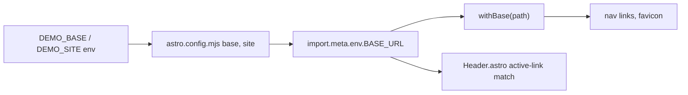
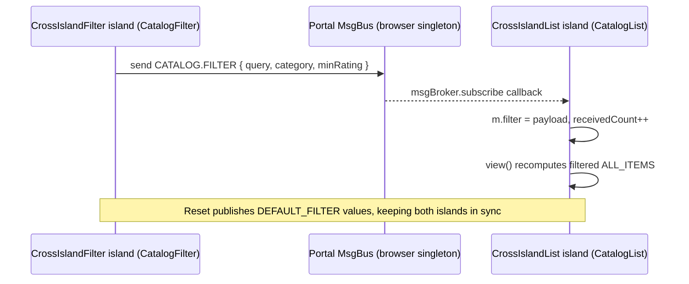
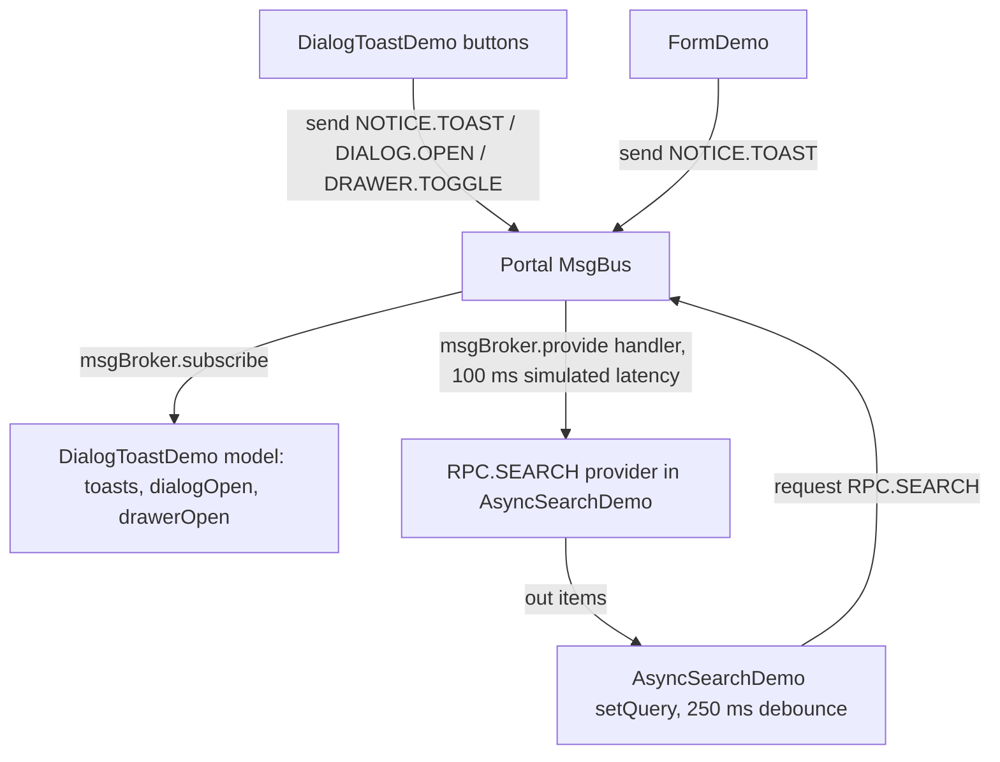
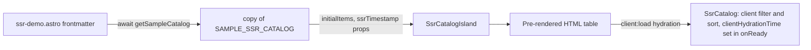

# @actdim/dynstruct-demo Architecture

> The demo app lives in [`demo/`](../demo/README.md) of this repository; file paths in this article are relative to `demo/`.
>
> - **Live Demo**: [https://actdim.github.io/dynstruct/demo/](https://actdim.github.io/dynstruct/demo/)
> - **Documentation**: [https://actdim.github.io/dynstruct/](https://actdim.github.io/dynstruct/)

## 1. System Overview

`@actdim/dynstruct-demo` is an Astro portal that showcases `@actdim/dynstruct` (structure-first component model), `@actdim/dynstruct-mui` (Material UI adapters for Dynstruct contracts) and `@actdim/msgmesh` (typed message bus). It is built as a static site (`astro build`, default `output: 'static'`) and deployed to GitHub Pages at https://actdim.github.io/dynstruct/demo/.

The page is split into two worlds:

- **Astro shell** (`.astro` files, Tailwind CSS): document layout, header, footer, hero banners and explanatory text. It renders to plain HTML at build time and ships no JavaScript of its own.
- **React islands** (`src/components/islands/*.tsx`, all mounted with `client:load`): interactive regions. Each island is an independent React root hydrated over its pre-rendered HTML. Material UI and Emotion run only inside islands.

```text
+--------------------------------------------------------------------------------------+
|  Astro shell (build time, zero JS)                                                   |
|  src/layouts/Layout.astro -> Header.astro, <slot />, Footer.astro, global.css        |
|  src/pages/*.astro (route = file name), src/lib/withBase.ts                          |
+--------------------------------------------------------------------------------------+
|  React islands (client:load, one React root each)                                    |
|  src/components/islands/*.tsx -> PortalProvider (MUI ThemeProvider +                 |
|                                  ComponentContextProvider { msgBus })                |
+--------------------------------------------------------------------------------------+
|  Dynstruct structs (src/components/structs/*.tsx)                                    |
|  ComponentStruct contract -> ComponentDef (props, actions, msgBroker, events, view)  |
|  useComponent(def, params) + toReact(...) -> React component                         |
+--------------------------------------------------------------------------------------+
|  Bus layer (src/bus)                                                                 |
|  portalMsgStruct.ts (DemoMsgStruct), portalBus.ts (getPortalMsgBus), ids.ts          |
+--------------------------------------------------------------------------------------+
|  Data (src/data): sampleCatalog.ts (SSG data), codeSnippets.ts (playground regions)  |
+--------------------------------------------------------------------------------------+
```

## Core Components

| Component | Location | Responsibility |
|---|---|---|
| Astro config | `astro.config.mjs` | `@astrojs/react` integration, Tailwind Vite plugin, `base` / `site` from `DEMO_BASE` / `DEMO_SITE`, Vite `server.fs.allow` with upward root discovery (`findAllowedRoots`) for monorepo and standalone compatibility, Vite `resolve.dedupe` and `ssr.noExternal` for `@actdim/*`, `react`, `react-dom`, `@emotion/*`, `@mui/material` |
| Layout | `src/layouts/Layout.astro` | HTML document, `title` / `description` props, favicon through `withBase`, header and footer around the page slot |
| Header / Footer | `src/components/astro/Header.astro`, `Footer.astro` | Navigation (base-aware active-link matching), links to the dynstruct `llms.txt` (docs site) and the `@actdim` GitHub repositories |
| Pages | `src/pages/index.astro`, `ssr-demo.astro`, `cross-island.astro`, `showcase.astro` | One route each; mount one or two islands with `client:load` |
| PortalProvider | `src/components/common/PortalProvider.tsx` | Dark MUI theme plus Dynstruct `ComponentContextProvider` whose `msgBus` is `getPortalMsgBus()` |
| Islands | `src/components/islands/*.tsx` | Thin wrappers: `PortalProvider` + one struct (or the playground / gallery) |
| Structs | `src/components/structs/*.tsx` | Idiomatic Dynstruct components: `CatalogFilter`, `CatalogList`, `SsrCatalog`, `FormDemo`, `Counter`, `DialogToastDemo`, `ReactivityDemo`, `AsyncSearchDemo` |
| Portal bus | `src/bus/portalBus.ts` | `getPortalMsgBus()`: browser singleton, fresh bus per call during SSR; `CATALOG.FILTER` configured with `replayBufferSize: 1` |
| Bus contract | `src/bus/portalMsgStruct.ts` | `DemoMsgStruct = BaseAppMsgStruct & MsgStruct<DemoCustomChannels>`, payload types, `DEFAULT_FILTER` |
| Message ids | `src/bus/ids.ts` | `newMsgId()`: `crypto.randomUUID()` with a counter fallback; used for toast ids |
| Base path helper | `src/lib/withBase.ts` | Prefixes root-relative links with `import.meta.env.BASE_URL` |
| Playground snippets | `src/data/codeSnippets.ts` | Imports struct sources with `?raw` and cuts `// #region contract|model|integration` blocks for the code panel |
| SSG data | `src/data/sampleCatalog.ts` | `getSampleCatalog()`: async server-side data source for `/ssr-demo` |

### 2.1. Astro shell vs React islands

The shell owns everything that does not need interactivity, so the first paint has no CSS-in-JS and no layout shift. MUI and Emotion are loaded only by islands. Every island is mounted with `client:load`, so it hydrates as soon as the page loads; the e2e helper `waitForIslands` (`e2e/hydration.ts`) waits until no `astro-island[ssr]` element remains.

The home page playground (`SplitPlaygroundIsland`) is a plain React component for the scenario selector and code tabs; the live preview inside it renders one Dynstruct struct per scenario under a `PortalProvider`. The code panel content is taken from the real struct source files, not from copies (`extractRegion` in `src/data/codeSnippets.ts`).

### 2.2. Cross-island msgmesh bus

React Context cannot cross island boundaries: each island has its own React root and its own `PortalProvider`. The shared channel is the module-level bus singleton returned by `getPortalMsgBus()` in the browser. Islands on the same page import the same module instance, so they publish and subscribe on the same `MsgBus<DemoMsgStruct>` without a common React ancestor.

During SSR / SSG (`typeof window === 'undefined'`) the function returns a new bus per call, so no state leaks between island renders or between pages at build time.

### 2.3. Declarative msgBroker

Structs register subscriptions and RPC providers inside `def.msgBroker` instead of calling `msgBus.on` / `msgBus.provide` by hand:

- `msgBroker.subscribe` - `CatalogList` (`CATALOG.FILTER`), `DialogToastDemo` (`NOTICE.TOAST`, `DIALOG.OPEN`, `DRAWER.TOGGLE`).
- `msgBroker.provide` - `AsyncSearchDemo` (`RPC.SEARCH`).

Dynstruct binds these registrations to the component lifecycle and releases them per mount, which keeps them correct under React StrictMode double mounting. Publishing stays imperative through `c.msgBus.send(...)` and requests through `c.msgBus.request(...)`. Each struct declares the channels it touches in its `msgScope` (`publish`, `subscribe`, `provide`), which the type system checks against `DemoMsgStruct`.

### 2.4. SSG / SSR switch

`/ssr-demo` awaits `getSampleCatalog()` in the page frontmatter and passes the result into `SsrCatalogIsland` as `initialItems` together with an `ssrTimestamp`. With the default `output: 'static'` this runs once at build time (SSG), so the generated HTML already contains every catalog row and is readable with JavaScript disabled. Moving to on-demand SSR needs `output: 'server'` in `astro.config.mjs` plus an Astro deployment adapter; page and component code stay unchanged. The deployed GitHub Pages site is static, so it uses SSG.

### 2.5. Base-path handling

GitHub Pages serves the site under `/dynstruct/demo/`. `astro.config.mjs` reads `DEMO_BASE` (default `/`) into `base` and `DEMO_SITE` into `site`. All internal links go through `withBase(path)`, which strips the trailing slash from `BASE_URL` and prefixes the path. `Header.astro` strips the base from `Astro.url.pathname` before comparing it with its base-relative nav items, so active-link highlighting works both locally and on Pages.



## Data Flow

### 3.1. Cross-island filter (`/cross-island`)



`CatalogFilter` publishes on every change of query, category or minimum rating; the category value `ALL` is sent as `category: undefined`. The channel has `replayBufferSize: 1`, so a subscriber that attaches after the last publish still receives the current filter.

### 3.2. Playground overlays and RPC (`/`)



`AsyncSearchDemo` numbers each request (`searchSeq`) and ignores responses that are not the latest, so out-of-order RPC replies never overwrite newer results.

### 3.3. Build-time data (`/ssr-demo`)



## Invariants

1. **MUI only inside islands**: `.astro` files use Tailwind classes only; `@mui/material` and Emotion are imported only from `src/components/islands`, `src/components/structs` and `src/components/common`.
2. **No React Context across islands**: islands communicate only through the portal bus. Each island wraps its content in its own `PortalProvider`.
3. **One browser bus, isolated SSR buses**: `getPortalMsgBus()` returns a singleton when `window` exists and a fresh bus otherwise. Do not create other buses for portal traffic.
4. **Declarative registrations**: subscriptions and RPC providers live in `def.msgBroker`; no manual `msgBus.on` / `msgBus.provide` in `events.onReady` / `onDestroy`.
5. **Typed channels**: every channel and payload is declared in `DemoCustomChannels` (`src/bus/portalMsgStruct.ts`) and listed in the struct's `msgScope`.
6. **Base-aware links**: every internal URL in the shell goes through `withBase`; never hard-code `/dynstruct/demo/`.
7. **Playground code comes from source**: structs shown in the playground keep `// #region contract`, `// #region model` and `// #region integration` markers; `extractRegion` throws when a marker is missing.
8. **Hydration-clean markup**: no block elements inside `span` / `p` (for example `ListItemText` uses `slotProps` with `component: 'div'`); the e2e suite fails on any browser console error or warning.
9. **Single React / dynstruct / MUI copy**: `resolve.dedupe` in `astro.config.mjs` lists `@actdim/dynstruct`, `@actdim/msgmesh`, `@actdim/utico`, `react`, `react-dom` and MUI packages so that ComponentContext and singletons are shared across sibling packages and client islands.
10. **Monorepo-aware Vite fs allow list**: `astro.config.mjs` discovers ancestor workspace and git roots (`findAllowedRoots`) so that Vite dev server can serve hoisted dependencies (such as `@astrojs/react` client hydration runtime) without 403 Forbidden errors across nested `pnpm-workspace.yaml` boundaries.
11. **Zero useState canon**: all interactive demo UI elements (`Playground`, `ShowcaseGallery`, etc.) strictly dogfood Dynstruct (`ComponentStruct` + `ComponentDef` + `useComponent` + `toReact`); local React `useState` hooks are banned in favor of Dynstruct reactive model props.
12. **Zero-FOUC theme synchronization**: `Layout.astro` initializes document theme via a blocking `<head>` script, while `PortalProvider` observes theme updates via reactive store to synchronize Material UI palette modes across all mounted islands without page reload.

## Related Topics

- [Domain Model](./topic--demo-domain-model.md): bus channels, payload contracts, catalog types and routes.
- [Setup And Workflow](./topic--demo-setup-and-workflow.md): running, testing and the GitHub Pages pipeline.
- [README](../demo/README.md): package overview and channel table.
